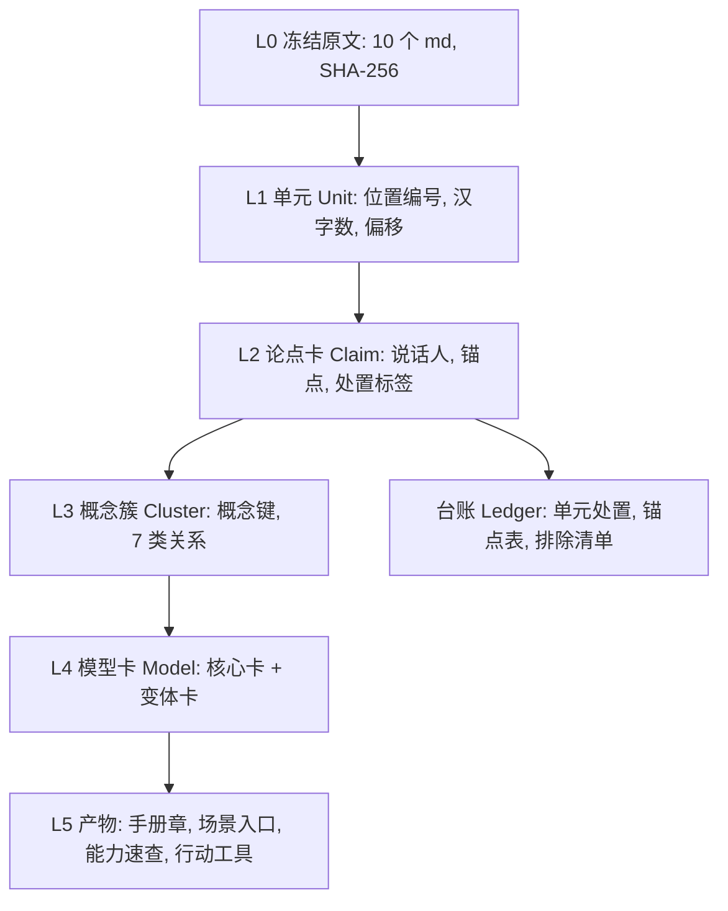

# 吴军十书整合：工程化总纲（Project Operating Spec）

| 项 | 内容 |
|---|---|
| 版本 | v1.0（2026-10-20） |
| 定位 | 把"十书整合"当作一个**整体工程**来规划、执行、验收。本文是工程总纲：需求追溯、架构、角色、工作分解、工单规范、质量闸门、配置与变更、里程碑发布、监控、风险与决策日志 |
| 与其他文档的关系 | 规格以《吴军十书整合_混合方案H_v2_全局规划与执行方案.md》（下称"**v2 方案**"）为准；稳定性机制以《长任务稳定性与上下文工程方案》为准；新窗口接手以《项目交接文档与新窗口开场提示词》为入口。本文引用 v2 方案章节时写作"v2 §x.y" |
| 适用对象 | 任何要规划或执行本工程的 AI Agent（Claude、Codex、Cursor、Claude Code 等）和你本人 |
| 状态 | 规划完成，**P0 未开始**；等待你确认 v2 方案 §18 的待确认项（4 项带★） |

---

## 0. 项目一页纸

| 项 | 内容 |
|---|---|
| 项目名 | WJ-OS：吴军十书 · 认知与行动操作系统 |
| 目标 | 把吴军 10 本书（硅谷来信1/3、吴军来信2、谷歌方法论、见识、格局、境界、富足、态度、数学通识50讲，约 504 万汉字）整合成一套**可信、可追溯、按场景调用**的个人认知与行动操作系统，服务跨境电商供应链 B 端产品经理兼工程师；重点是职场、认知格局、个人成长 |
| 产品形态 | 一份主手册（核心模型卡为本体，场景入口与能力速查为索引）+ 行动工具集 + 溯源与处置台账 + 质检报告 + 盘点清单 + 决策记录，全部 Markdown |
| 做什么 | 盘点冻结 → 试点 → 分诊 → 分层抽取 → 聚类归属 → 成稿 → 校验 → 交付；每个论点有出处、有适用边界、有落地映射 |
| 不做什么 | 不写吴军没说过的话；不把读者发言和第三方观点当吴军观点；不放长段原文引文；不做宏观经济、科技趋势、文明史、教育家庭类支柱；不用 docx、PDF、artifact、Claude Docs 交付；不追图片路径；不做岗位映射附录；不承诺"绝对无遗漏"，只承诺"可证明" |
| 成功标准 | v2 §9 的全部验收条目通过（AC-0.x 至 AC-7.x，共 59 条）；覆盖三层口径达标；你的抽查 20 张无重大异议；你用手册解决 3 个真实问题 |
| 硬约束 | 事实源冻结；覆盖 = 每个单元有处置；10 个一级支柱；三道门；规则①–⑫；排除准则 X1–X8；分批 3–5 万汉字；每批校验和回顾；说话人先行；数理映射可检验（详见交接文档 §8） |
| 工作量（估算） | 约 70–90 批，40–70 轮（中位约 55）；P1 试点后校准 |
| 当前阶段 | 第二步规划已完成并交付 v2 方案；进入第三步前需你确认 |

---

## 1. 工程化原则

| # | 原则 | 落实 |
|---|---|---|
| E1 | 规格先行，可追溯 | 每条需求有编号，追溯到设计、工单、验收、交付物（§2） |
| E2 | 仓库即真相 | 状态、规格、数据、日志都在仓库文件里；对话是易失的界面 |
| E3 | 脚本优先 | 能脚本的不靠 LLM；LLM 只做语义判断 |
| E4 | 工单驱动 | 每轮只做 1 张自包含工单；有前置、输入、动作、输出、验收、回退 |
| E5 | 小步提交 | 每批写盘；失败最多丢 1 批 |
| E6 | 闸门停线 | 任何闸门不过，立即停，不进入下一工单 |
| E7 | 规格不可变，日志只增 | 规格改动只走变更控制；日志不改只增 |
| E8 | 独立复核 | 抽取、审计、成稿分角色；审计用全新窗口 |
| E9 | 可复现 | 固定随机种子、版本号、SHA-256；数字由脚本复算 |
| E10 | 渐进交付 | M1–M4 每个里程碑都可独立使用，并声明未覆盖范围 |
| E11 | 变更受控 | 大变更须你批准；变更记录受影响范围并重跑 |
| E12 | 失败可恢复 | 压力测试 ST-1 至 ST-6 验证恢复能力 |

---

## 2. 需求清单与追溯矩阵

### 2.1 需求清单

标注：**U** = 你明确提出或确认；**D** = 我提出、你未反对而默认生效；**P** = 待你确认。

| REQ | 需求 | 类型 | 来源 |
|---|---|---|---|
| REQ-01 | 把 10 本书整合为"认知与行动操作系统"手册，不是书籍大纲拼盘 | U | 你的初始需求 |
| REQ-02 | 结构：两大分类 + 10 个一级支柱 + 二级 + 三级；数量不设硬上限但不要太多 | U | 你的确认 |
| REQ-03 | 五层：两大分类、内容支柱、核心模型、场景入口、溯源底账 | U | 你的初始需求 |
| REQ-04 | 归属边界规则①–⑫，含判例 | U/D | 你定①②③⑧，同意④⑤⑥⑦⑨，⑩⑪⑫ 为我新增默认生效 |
| REQ-05 | 重点倾斜：职场、认知格局、个人成长，篇幅约占一半 | U | 你的确认 |
| REQ-06 | 可信：有出处、不虚构、说话人先行、数理映射可检验、防"伪原著"与"拼盘" | U | 你的初始需求 |
| REQ-07 | 覆盖口径三层：单元处置率 100%、核心论点覆盖、抽检召回 | U | 你的确认 |
| REQ-08 | 分批 3–5 万汉字，台账，强制回顾 | U | 你的初始需求 |
| REQ-09 | 去重收敛、冲突消解 | U | 你的初始需求 |
| REQ-10 | 交付物：主手册、行动工具集、溯源与处置台账、覆盖与质检报告、内容盘点与单元清单、方案决策与裁决记录，加里程碑进度台账；仅 Markdown | U | 你的确认 |
| REQ-11 | 行动工具集 | U | 你的确认 |
| REQ-12 | 盘点与清点方案，确保可证明无遗漏 | U | 你的追问 |
| REQ-13 | 排除准则：宏观、科技趋势、文明史、教育家庭不作支柱；游记、移民默认排除，可点名拉回 | U | 你的确认 |
| REQ-14 | 能力标签轴（思考、学习、沟通、做事）与三个能力二级簇 | U/P | 你提议；规格待你确认 |
| REQ-15 | 过程方法：先理解、再规划、后执行；对抗式审查；交付前验证；决策留痕 | U | 你的长期偏好 |
| REQ-16 | 输出规范：中文、先结论、信息密度优先、表格、Mermaid、命令带路径 | U | 你的长期偏好 |
| REQ-17 | 人工验证：抽查 20 张，使用验证（真实工作问题） | U | 你的确认 |
| REQ-18 | 事实源冻结（沿用本包 10 本，不补传其他 AI 文件） | U/P | 你确认沿用；冻结承诺待确认 |
| REQ-19 | 长任务稳定性：抗注意力稀疏、抗上下文压缩丢信息 | U | 你的追问 |
| REQ-20 | 工程化与可移交：其他 AI Agent 能规划、执行；有交接文档和开场提示词 | U | 你的追问 |

### 2.2 追溯矩阵

| REQ | 设计依据（v2 方案） | 工单 | 验收 | 交付物 |
|---|---|---|---|---|
| REQ-01 | v2 §1、§5 | T-P5-* | AC-5.1–5.8，AC-6.2 | D1 |
| REQ-02 | v2 §5.3、§13 | T-P4-06、T-P4-07、T-P4-09 | AC-4.5、AC-4.6 | D1、D3 |
| REQ-03 | v2 §5.2 | T-P5-* | AC-5.1、AC-5.4 | D1、D3 |
| REQ-04 | v2 §5.4、§13.4、§15.9 | T-P4-05、T-P1-10 | AC-4.4、AC-4.8 | D3 |
| REQ-05 | v2 §14.3 | T-P5-01、T-P5-02 | AC-5.3 | D1 |
| REQ-06 | v2 §5.6–§5.9、§5.13、§15.6–§15.7 | T-P1-*、T-P3*-B-* | AC-1.1、AC-1.2、AC-3.2、AC-3.4、AC-6.5、AC-6.8 | D3、D4 |
| REQ-07 | v2 §9.0 | T-P4-12、T-P6-02、T-P6-03 | AC-3.5、AC-3.6、AC-6.2、AC-6.3 | D3、D4 |
| REQ-08 | v2 §7.3、§15.5.4 | T-P3a-B-*、T-P3b-B-* | AC-3.1–AC-3.4 | D3 |
| REQ-09 | v2 §5.8、§15.8 | T-P4-02 至 T-P4-04 | AC-4.2、AC-4.3 | D3 |
| REQ-10 | v2 §8 | T-P7-04 | AC-7.1 | 全部 |
| REQ-11 | v2 §5.11 | T-P5-06 | AC-5.5 | D2 |
| REQ-12 | v2 §6 | T-P0-* | AC-0.1–AC-0.9 | D5 |
| REQ-13 | v2 §5.12 | T-P2-04、T-P2-08 | AC-2.2 | D3 |
| REQ-14 | v2 §3.1 | T-P1-08、T-P5-10 | AC-5.6 | D1 |
| REQ-15 | v2 §4.6、§17 | T-P6-10 | AC-6.9 | D4、D6 |
| REQ-16 | 交接文档 §3 | 全部 | 自检清单 | 全部 |
| REQ-17 | v2 §7.6、§12.2 | T-P4-11、T-P6-11 | AC-4.8、AC-6.10 | D4 |
| REQ-18 | v2 §0.3、§6.1 | T-00-01、T-P0-01 | AC-0.1 | D5 |
| REQ-19 | 稳定性方案 §5–§8 | T-00-05 至 T-00-08、T-P1-12 | ST-1 至 ST-6 | 工程工件 |
| REQ-20 | 本文、交接文档 | T-00-01 至 T-00-08 | 复水测验 ≥11/12 | 本文、交接文档 |

---

## 3. 系统架构

### 3.1 数据分层（单向依赖：上层只引用下层）



**依赖规则**：L5 只引用 L4；L4 只引用 L3、L2；L2 只引用 L1；L1 只引用 L0。禁止反向引用和跨层跳引（锚点是唯一允许的"直达原文"通道，且只在 L2 层定义）。

### 3.2 仓库结构

```text
wujun-os/
├─ README.md、AGENTS.md          # 入口：开场提示词、读取顺序
├─ spec/                          # 规格（只读，版本化）
│  ├─ v2_方案.md                  # 本工程的规格主体
│  ├─ constraints.md              # 硬约束清单（带编号，每轮复述）
│  ├─ pillars.yaml                # 10 个一级、25 个二级的机读字典
│  ├─ exclusions.yaml、boundary_rules.md
│  └─ schemas/                    # 单元、论点卡、模型卡、工具的字段规格
├─ prompts/                       # 角色提示词、开场提示词、阶段追加段
├─ handover/                      # 自动生成：项目交接文档、开场提示词
├─ src_frozen/                    # 10 个原文 md（只读）
├─ rules/                         # 配置：split_*.yaml、concept_keys.csv、watchlist、precedents.md
├─ scripts/                       # S00–S18、make_handover、tests/
├─ data/                          # units/、cards/、gold/（黄金样例）
├─ state/                         # STATE.md、state.json、journal.md、board.md、decisions.md、changes.md、LOCK
├─ ledger/                        # 汇总台账（由脚本生成）
├─ out/                           # 交付物草稿 D1–D6
├─ logs/                          # 对账输出（带时间）
└─ Makefile                       # 统一命令入口
```

### 3.3 Makefile 命令规格（统一入口，Agent 与你都只用这几个）

| 命令 | 作用 |
|---|---|
| `make freeze` | 解压并冻结原文，登记哈希（S00） |
| `make p0` | 依次运行 S01–S08，生成 D5 |
| `make test` | 运行全部脚本自测 |
| `make gates` | 运行当前阶段的闸门（G0–G10 子集与 lint） |
| `make status` | 渲染 STATE.md 并打印进度条 |
| `make handover` | 生成交接文档与开场提示词，并写入新鲜度校验和 |
| `make drift` | 对黄金单元做漂移回归（输出待比对的重抽任务清单） |
| `make verify-anchors` | 用 `anchor_tool.py verify` 校验台账里的全部锚点 |

### 3.4 组件与接口

| 组件 | 职责 | 输入 → 输出 | 接口约定 |
|---|---|---|---|
| 冻结与切分（S00–S01） | 冻结原文、切分单元 | zip → `src_frozen/`、`data/units/` | 单元 ID 规则见 v2 §16.1 |
| 对账（S02–S08） | G0–G8 | 单元 → `logs/`、D5 | 任一关失败返回非零退出码 |
| 单元卡与装箱（S09–S10） | 分诊与批次 | 单元 → 单元卡、批次清单 | 批 3–5 万汉字，单元整块 |
| 锚点（anchor_tool） | 生成与校验锚点 | 原文 + 探针短语 → 锚点行 | 8 列表格，列序固定（v2 §16.7） |
| 台账汇总（S12） | 卡 → 台账 | `data/cards/` → `ledger/` | 与卡一致，不手改 |
| 指标与闸门（S13–S17） | 关键词反查、重合率、κ、lint | 各产物 → 指标 | 阈值见 v2 §9 |
| 交接生成（make_handover） | 派生交接文档 | spec + state → handover/ | 带新鲜度校验和 |

---

## 4. 角色与职责

| 角色 | 职责 | 输入 | 输出 | 禁止 |
|---|---|---|---|---|
| R-ORCH 编排者 | 读状态、发工单、做阶段门裁决、写决策和变更、向你汇报 | STATE、board、规格 | 工单、决策、交接块 | 亲自抽取论点；改规格而不走变更控制 |
| R-EXT 抽取者 | 按工单读原文、判说话人、抽论点卡、生成锚点 | 工单、原文片段、字典条目 | 卡文件、批末回顾 | 看其他批的推理；凭记忆写论点 |
| R-AUD 审计者 | 重抽、盲重标、抽检召回、对抗式审查 | 全新窗口，只读卡片与原文 | 审计报告、缺陷单 | 读抽取者的推理；改卡 |
| R-WRT 成稿者 | 按模型清单写模型卡、场景入口、工具、手册 | 模型清单、论点卡 | D1、D2 草稿 | 写没有出处的内容；改归属 |
| R-OPS 工程者 | 写与测脚本、维护仓库、生成交接文档 | 规格、脚本规格 | 脚本、自测、基建 | 改数据；改规则 |

**单 Agent 环境**下，同一个 Agent 在不同工单里扮演不同角色；R-AUD 必须用**全新窗口**，不读 R-EXT 的推理，只读它的产出。

**角色提示词骨架**（完整版放 `prompts/`）：

| 角色 | 提示词骨架（要点） |
|---|---|
| R-EXT | 你是抽取者。只依据本工单列出的原文片段写卡；无锚点不写；说话人先判；转述 ≤60 字；不连续照抄 >15 字；边界字段只写原文给出的；每批结束写批末回顾并校验锚点；遇到异常按手册 §15.10 处理，不确定就停下问 |
| R-AUD | 你是审计者。你没有看过抽取者的推理。只读原文和卡片，独立判断说话人、处置和归属；发现缺陷写缺陷单，不改卡；报告重合率和漏收项 |
| R-WRT | 你是成稿者。只写模型清单里已有的卡；每句话要能追到论点卡 ID；原著与映射分栏；没有证据的必检议题写"本包原著未涉及" |
| R-OPS | 你是工程者。脚本必须幂等、可自测、固定种子、输出带版本；不修改 `src_frozen/`；任何数字必须由脚本产生 |
| R-ORCH | 你是编排者。每轮先复水，再领工单；闸门不过就停线；变更走 CHG；大变更必须问用户；每个里程碑生成交接文档 |

---

## 5. 工作分解（WBS）

### 5.1 工作包总览

| 工作包 | 内容 | 工单数 | 估算轮次 | 里程碑 | 主角色 |
|---|---|---|---|---|---|
| EP-0 工程基建 | 仓库、规格落库、脚本、闸门、状态与交接、复水测验、角色提示词、压力测试 | 8 | 3–5（新增，不含在 v2 的 40–70 内） | — | R-OPS、R-ORCH |
| EP-1 P0 冻结与盘点 | G0–G8、单元清单、分母冻结 | 12 | 1–2 | M1 | R-OPS |
| EP-2 P1 试点门 | 试点抽取、双盲重抽、规则 v1、压力测试 ST-2 与 ST-3 | 12 | 2–3 | M1 | R-EXT、R-AUD |
| EP-3 P2 分诊 | 单元卡、读法层、X 候选 | 10 | 3–5 | — | R-EXT |
| EP-4 P3a 成书与骨架 | A 层批次工单 | 约 28 批 | 9–14 | M2 | R-EXT |
| EP-5 P3b 来信与问答 | B 层批次工单，C 层并行处置 | 约 30–47 批 | 10–24 | M3 | R-EXT |
| EP-6 P4 聚类与归属 | 概念键、关系、归属、L2/L3、盲重标 | 13 | 4–6 | — | R-ORCH、R-AUD |
| EP-7 P5 成稿 | 按章成稿、工具、速查、附录 | 11 | 7–10 | — | R-WRT |
| EP-8 P6 校验 | 全量闸门、抽检召回、对抗式审查 | 12 | 3–5 | M4 | R-AUD |
| EP-9 P7 交付 | 渲染检查、打包、交付说明 | 5 | 1 | M4 | R-ORCH |

**含 EP-0 的总轮次约 43–75（中位约 58）**；P1 试点后与吞吐一并校准。这是对 v2 方案"40–70 轮"的更新，已列入待确认项（交接文档 §7）。

### 5.2 EP-0 工程基建工单

| 工单 | 名称 | 前置 | 输出 | 验收（DoD） | 角色 |
|---|---|---|---|---|---|
| T-00-01 | 初始化仓库结构并放入冻结原文 | 你确认 v2 §18 的★项 | 目录树、`src_frozen/` 只读 | 目录与 §3.2 一致；`src_frozen/` 无写权限；10 个文件齐全且哈希与交接文档 §16 一致 | R-OPS |
| T-00-02 | 规格落库 | T-00-01 | `spec/` 下的 v2 方案、constraints.md、pillars.yaml、exclusions.yaml、boundary_rules.md、schemas/ | pillars.yaml 解析后一级 10 个、二级 25 个，与 v2 §13.1 一致；constraints.md 编号完整 | R-ORCH |
| T-00-03 | 脚本 S00–S08 及自测 | T-00-02 | `scripts/`、`tests/` | 每个脚本自测通过；对本包复现前置数字：1,742 = 1,697 + 32 + 13，汉字 5,038,558 | R-OPS |
| T-00-04 | 闸门与 lint 骨架 | T-00-03 | `check_all`、`lint`、Makefile | `make gates` 对示例单元运行成功；故意注入错误时返回非零 | R-OPS |
| T-00-05 | 状态与日志基建、交接生成脚本 | T-00-02 | `state/` 模板、`make_handover` | 由 `state.json` 能渲染 STATE.md；生成的交接文档带新鲜度校验和 | R-OPS |
| T-00-06 | 复水测验题库与黄金样例占位 | T-00-05 | 题库（≥12 题）、`data/gold/` 占位 | 每题答案可由 spec 复算 | R-ORCH |
| T-00-07 | 角色提示词与开场提示词入库 | T-00-05 | `prompts/`、`AGENTS.md` | 5 个角色提示词、开场提示词、阶段追加段齐全 | R-ORCH |
| T-00-08 | 压力测试规程与首次干跑 | T-00-04、T-00-06、T-00-07 | ST-1 至 ST-6 规程、干跑报告 | ST-1、ST-4、ST-5、ST-6 干跑通过（ST-2、ST-3 在 T-P1-12） | R-AUD |

### 5.3 P0–P7 工单（由 v2 §15.5 的逐步剧本生成，与规格保持一致）

P3 的批次工单由 S10 装箱后逐批生成，下表以模板行表示。动作的完整描述见各行"规格出处"。

| 工单 | 名称 | 前置 | 输出 | 验收（DoD） | 失败回退 | 角色 | 规格出处（v2） |
|---|---|---|---|---|---|---|---|
| T-P0-01 | 建工作区，运行 S00 冻结输入 | T-00-08 | src_frozen/、g0_inputs.md | 10/10 登记，文件名无乱码 | 乱码：用 zipfile 解码重做 | R-OPS | §15.5.1 步 1 |
| T-P0-02 | 为每本写切分规则 split_<书码>.yaml：单元层级、容器标题… | T-P0-01 | 10 个规则文件 | 与 §3.2、§6.1 的前置发现一致 | 不一致：回读原文核对，修规则 | R-OPS | §15.5.1 步 2 |
| T-P0-03 | 运行 S01 切分 | T-P0-02 | units/、units_index.csv | 总 1,742 = 1,697 + 32 + 13；各书与附录 B.1 一致 | **不一致先查原因，不改数**；可能是规则差异 | R-OPS | §15.5.1 步 3 |
| T-P0-04 | 运行 S02：行覆盖与汉字守恒 | T-P0-03 | g2g3.md | 缺口 0、重叠 0、差 0 | 逐行定位缺口，修规则后整体重跑 | R-OPS | §15.5.1 步 4 |
| T-P0-05 | 运行 S03：编号连续 | T-P0-04 | g4.md | 缺号逐条定性 | 来信3 答读者问 48：读上下文判断是源缺失、编号跳还是… | R-OPS | §15.5.1 步 5 |
| T-P0-06 | 运行 S04：自动目录一致性（a）和谷歌作者目录（b） | T-P0-05 | g5.md | 差集逐条定性；谷歌 219/223，缺 021–024 | 境界的目录差异逐项核对 | R-OPS | §15.5.1 步 6 |
| T-P0-07 | 运行 S05：重复扫描 | T-P0-06 | g6.md | 重复簇表；双出处登记 | — | R-OPS | §15.5.1 步 7 |
| T-P0-08 | 运行 S06：非原著与风险标注 | T-P0-07 | g7.md | 无未分类项 | 未分类项人工判定并补规则 | R-OPS | §15.5.1 步 8 |
| T-P0-09 | 运行 S07：反向抽查 | T-P0-08 | g8.md | ≥100 位置、≥60 单元，差异 0；首中尾对读无差异 | 有差异：定位切分边界，修规则，整体重跑 G2–G8 | R-OPS | §15.5.1 步 9 |
| T-P0-10 | 缺号与异常逐条定性，写入异常台账 | T-P0-09 | 异常台账 | 100% 有定性 | 无法判断：列入待确认，问用户 | R-OPS | §15.5.1 步 10 |
| T-P0-11 | 运行 S08：生成 D5；冻结分母（总单元、内容单元、汉字数） | T-P0-10 | D5、进度台账 v0 | G0–G8 全过 | 任一关失败：停，写异常报告 | R-OPS | §15.5.1 步 11 |
| T-P0-12 | 本轮交付：D5、进度台账 v0，并请用户确认缺号定性与分母 | T-P0-11 | — | — | — | R-OPS | §15.5.1 步 12 |
| T-P1-01 | 按 §7.5 选样（脚本按条件选，我微调），列表给用户过目 | T-P0-12 | 选样表 | 覆盖 14 类样本 | 缺类：补选 | R-EXT | §15.5.2 步 1 |
| T-P1-02 | 用户确认选样后，逐个单元按 §15.7 抽卡 | T-P1-01 | cards/ 试点卡 | 字段齐全 | — | R-EXT | §15.5.2 步 2 |
| T-P1-03 | 每张卡生成锚点并校验（S11） | T-P1-02 | 锚点表 | 100% 通过 | 见异常手册 3、4、5 | R-EXT | §15.5.2 步 3 |
| T-P1-04 | 对 6 个回归组运行 S13 关键词反查，判定关系类型 | T-P1-03 | g10_kw.md | 命中段落全有去向 | 漏查：补词表 | R-EXT | §15.5.2 步 4 |
| T-P1-05 | **隔一轮**对同一批单元做双盲重抽（不看首次卡） | T-P1-04 | 第二份卡 | — | — | R-EXT | §15.5.2 步 5 |
| T-P1-06 | 运行 S14 计算重合率 | T-P1-05 | 重合率 | ≥0.7 通过；0.5–0.7 修规则补试点；<0.5 触发降级评估 | 见 §7.8 | R-EXT | §15.5.2 步 6 |
| T-P1-07 | 来信3 样本单元对照"划重点"算召回 | T-P1-06 | 召回率 | ≥90% | 修抽取规则 | R-EXT | §15.5.2 步 7 |
| T-P1-08 | 统计：能力标签可标注率、归属歧义率 | T-P1-07 | 统计表 | 按 §7.5 | 判断类 <60% 可标注则增设第 5 值 | R-EXT | §15.5.2 步 8 |
| T-P1-09 | 记录单批耗时与上下文占用，建议每轮 2 批还是 3 批 | T-P1-08 | 吞吐结论 | — | 吞吐过低：降级评估 | R-EXT | §15.5.2 步 9 |
| T-P1-10 | 复盘：列出规则问题，走变更控制，冻结规则 v1 | T-P1-09 | 规则 v1、变更日志 | — | — | R-EXT | §15.5.2 步 10 |
| T-P1-11 | 输出《试点报告》，请用户确认结论与是否触发降级 | T-P1-10 | 试点报告 | — | — | R-EXT | §15.5.2 步 11 |
| T-P1-12 | 压力测试 ST-2 压缩模拟、ST-3 漂移回归（补充工单，EP 稳定性方案） | T-P1-11 | 压力测试报告 | ST-2、ST-3 通过（稳定性方案 §8.2） | 修对应机制并重测；不进入 P2 | R-AUD | 稳定性方案 §8.2 |
| T-P2-01 | 运行 S09 生成单元卡 | T-P1-12 | unit_cards.md | 每个内容单元一张 | — | R-EXT | §15.5.3 步 1 |
| T-P2-02 | 运行 S10 把单元卡装箱为 3–5 万字的批 | T-P2-01 | 批次清单 | 单元整块、系列不拆 | — | R-EXT | §15.5.3 步 2 |
| T-P2-03 | 每批前复述规则摘要（§15.11） | T-P2-02 | — | — | — | R-EXT | §15.5.3 步 3 |
| T-P2-04 | 逐批读单元卡并标：读法层 A/B/C、候选支柱提示（≤2）、能力标签… | T-P2-03 | 分诊表 | 每个内容单元都有读法层 | — | R-EXT | §15.5.3 步 4 |
| T-P2-05 | 脚本核对强制规则：问答 B、周末互动 A、骨架 A、领域直连 A | T-P2-04 | 核对结果 | 执行率 100% | 修正漏标 | R-EXT | §15.5.3 步 5 |
| T-P2-06 | 系列单元成组（91 个） | T-P2-05 | 系列组表 | 91/91 | — | R-EXT | §15.5.3 步 6 |
| T-P2-07 | 批末回顾 | T-P2-06 | 回顾 | 三要素齐 | — | R-EXT | §15.5.3 步 7 |
| T-P2-08 | X 候选抽样回读 ≥30 个 | T-P2-07 | 抽样记录 | 核心论点遗漏 0 | 漏判：扩样到 60，修判定规则，重判受影响类 | R-EXT | §15.5.3 步 8 |
| T-P2-09 | 汇总：各层单元数、字数；更新批数与轮次估算；评估是否触发 Z1 | T-P2-08 | 分诊汇总 | — | — | R-EXT | §15.5.3 步 9 |
| T-P2-10 | 交付：分诊表（并入进度台账），请用户确认读法层规模 | T-P2-09 | — | — | — | R-EXT | §15.5.3 步 10 |
| T-P3a-B-nnn | 成书与骨架 A 层批次工单（模板，由 S10 装箱后逐批生成，约 28 批） | T-P2-10 | 卡文件、批末回顾、台账 | §15.5.4 第 7、11、13 步通过 | 批内校验失败不进下一批 | R-EXT | §15.5.4 |
| T-P3b-B-nnn | 来信与问答 B 层批次工单（模板，约 30–47 批；C 层并行处置） | T-P3a-B-最后一批 | 卡文件、批末回顾、台账 | 同上；每本抽检召回 100% | 同上 | R-EXT | §15.5.4 |
| T-P4-01 | 冻结 P3 产物：记录台账快照版本与哈希 | T-P3b-B-最后一批 | 快照记录 | — | 停线，写异常报告 | R-ORCH | §15.5.5 步 1 |
| T-P4-02 | 概念键归一：同一概念一个键，别名登记（§15.8） | T-P4-01 | concept_keys.csv | 概念键多处定义 0 | 停线，写异常报告 | R-ORCH | §15.5.5 步 2 |
| T-P4-03 | 用脚本的指纹和相似度列出近似卡对，人工判定 | T-P4-02 | 候选对表 | — | 停线，写异常报告 | R-ORCH | §15.5.5 步 3 |
| T-P4-04 | 按 7 类关系标注，冲突登记到冲突台账（F 编号） | T-P4-03 | 关系与冲突台账 | 冲突处置率 100% | 停线，写异常报告 | R-ORCH | §15.5.5 步 4 |
| T-P4-05 | 支柱归属：按 §15.9 决策树，遇歧义写判例 | T-P4-04 | 归属表、判例库 | 每张 K 卡主归属唯一 | 停线，写异常报告 | R-ORCH | §15.5.5 步 5 |
| T-P4-06 | 聚合 L3 核心模型节点，按增长门检验（§5.3.3） | T-P4-05 | 模型清单 | 每个 L3 的 K 卡 ≥3 张且 ≥2 个单元 | 停线，写异常报告 | R-ORCH | §15.5.5 步 6 |
| T-P4-07 | L2 定稿，执行薄簇条款 | T-P4-06 | L2 清单 | 薄簇已处理 | 停线，写异常报告 | R-ORCH | §15.5.5 步 7 |
| T-P4-08 | 创新与产品方法的三道门裁决，汇总证据 | T-P4-07 | 裁决记录 | 证据齐 | 停线，写异常报告 | R-ORCH | §15.5.5 步 8 |
| T-P4-09 | 数量核对：目标区间、预警线、红线 | T-P4-08 | 数量表 | 不超红线 | 停线，写异常报告 | R-ORCH | §15.5.5 步 9 |
| T-P4-10 | 盲重标：随机抽 5%（不少于 60 张）不看首次归属重新归属，S16… | T-P4-09 | κ 报告 | ≥0.6 | 停线，写异常报告 | R-ORCH | §15.5.5 步 10 |
| T-P4-11 | 你抽查 20 张 | T-P4-10 | 抽查表 | 归属明显错误 ≤3 张 | 停线，写异常报告 | R-ORCH | §15.5.5 步 11 |
| T-P4-12 | K 卡冻结，分母锁定，生成 K 降级审计表 | T-P4-11 | 审计表 | 降级数已报告 | 停线，写异常报告 | R-ORCH | §15.5.5 步 12 |
| T-P4-13 | 对照 §13，生成"字典变更报告"（若有变更，走 §15.13），请… | T-P4-12 | 变更报告 | — | 停线，写异常报告 | R-ORCH | §15.5.5 步 13 |
| T-P5-01 | 按 §14.7 的顺序逐章写（每章走下面 2–9 步） | T-P4-13 | — | — | 停线，写异常报告 | R-WRT | §15.5.6 步 1 |
| T-P5-02 | 取本章模型清单，写核心模型卡（9 字段） | T-P5-01 | 核心卡 | 字段齐 | 停线，写异常报告 | R-WRT | §15.5.6 步 2 |
| T-P5-03 | 写变体卡、条件分支卡、应用卡 | T-P5-02 | 变体卡 | 挂靠关系完整 | 停线，写异常报告 | R-WRT | §15.5.6 步 3 |
| T-P5-04 | 写"必检议题覆盖表"：逐议题标结局（成卡/并入/本包原著未涉及） | T-P5-03 | 覆盖表 | 112 个议题无空项 | 停线，写异常报告 | R-WRT | §15.5.6 步 4 |
| T-P5-05 | 写本章场景入口（来自已有卡） | T-P5-04 | 场景条目 | 每条指向模型 ID | 停线，写异常报告 | R-WRT | §15.5.6 步 5 |
| T-P5-06 | 写本章行动工具（T1 每步有锚点；T2 标「整合者推演」） | T-P5-05 | D2 条目 | 要素齐 | 停线，写异常报告 | R-WRT | §15.5.6 步 6 |
| T-P5-07 | 写章末覆盖声明 | T-P5-06 | 声明 | 与覆盖表一致 | 停线，写异常报告 | R-WRT | §15.5.6 步 7 |
| T-P5-08 | 运行 S17 lint | T-P5-07 | lint 报告 | 字段齐、ID 引用有效、无长引文 | 停线，写异常报告 | R-WRT | §15.5.6 步 8 |
| T-P5-09 | 对照论点卡抽检 3 张核心卡 | T-P5-08 | 抽检记录 | 无失真 | 停线，写异常报告 | R-WRT | §15.5.6 步 9 |
| T-P5-10 | 全章完成后：能力速查表 4 张、冲突消解表、附录、使用说明与全景、溯… | T-P5-09 | D1、D2 草稿 | 全文 lint 通过 | 停线，写异常报告 | R-WRT | §15.5.6 步 10 |
| T-P5-11 | 交付 v0.9 并请用户试用（M3 使用验证） | T-P5-10 | — | — | 停线，写异常报告 | R-WRT | §15.5.6 步 11 |
| T-P6-01 | S15 重跑 G0–G9 | T-P5-11 | 对账结果 | 全过 | 停线，写异常报告 | R-AUD | §15.5.7 步 1 |
| T-P6-02 | 核心论点覆盖（逐书）：双向矩阵加语义核验 | T-P6-01 | 覆盖矩阵 | 100% | 停线，写异常报告 | R-AUD | §15.5.7 步 2 |
| T-P6-03 | 抽检召回循环：成书每本 15 条、来信每本 10 条，有漏即补抽补写 | T-P6-02 | 抽检记录 | 样本 100% | 停线，写异常报告 | R-AUD | §15.5.7 步 3 |
| T-P6-04 | G10 ① 关键词反查全量复跑 | T-P6-03 | g10_kw.md | 命中段落 100% 有去向 | 停线，写异常报告 | R-AUD | §15.5.7 步 4 |
| T-P6-05 | G10 ③ 来信3 划重点召回 | T-P6-04 | 召回表 | ≥95% | 停线，写异常报告 | R-AUD | §15.5.7 步 5 |
| T-P6-06 | 数理映射可检验率 | T-P6-05 | 检查表 | 100% | 停线，写异常报告 | R-AUD | §15.5.7 步 6 |
| T-P6-07 | 5 个应用验证场景演练（含异常） | T-P6-06 | 演练记录 | 走通 | 停线，写异常报告 | R-AUD | §15.5.7 步 7 |
| T-P6-08 | 24 字滑窗机械重复检测 | T-P6-07 | 检测结果 | 0 | 停线，写异常报告 | R-AUD | §15.5.7 步 8 |
| T-P6-09 | 锚点全量校验；生成用户自助核验说明 | T-P6-08 | 校验结果 | 100% | 停线，写异常报告 | R-AUD | §15.5.7 步 9 |
| T-P6-10 | 对抗式审查（5 角度，列 3–5 个高风险点，核实并修正） | T-P6-09 | 审查记录 | 已修正 | 停线，写异常报告 | R-AUD | §15.5.7 步 10 |
| T-P6-11 | 你抽查 20 张并用手册解决 3 个真实问题 | T-P6-10 | 反馈记录 | 已回传 | 停线，写异常报告 | R-AUD | §15.5.7 步 11 |
| T-P6-12 | 缺陷定位到受影响卡，回 P4 或 P5 修复并重跑对应检查 | T-P6-11 | 修复记录 | 不整体返工 | 停线，写异常报告 | R-AUD | §15.5.7 步 12 |
| T-P7-01 | S18 渲染与链接检查 | T-P6-12 | 检查结果 | 表格列数一致、Mermaid 可渲染、无断链 | 停线，写异常报告 | R-ORCH | §15.5.8 步 1 |
| T-P7-02 | 汇总指标并写入 D4，附可复算的命令与路径 | T-P7-01 | D4 | 可复算 | 停线，写异常报告 | R-ORCH | §15.5.8 步 2 |
| T-P7-03 | 附事实源声明与冻结哈希、版本记录 | T-P7-02 | D4、D6 | — | 停线，写异常报告 | R-ORCH | §15.5.8 步 3 |
| T-P7-04 | 打包：D1–D6 与进度台账终版 | T-P7-03 | 交付清单 | 6 份齐 | 停线，写异常报告 | R-ORCH | §15.5.8 步 4 |
| T-P7-05 | 向用户交付并说明：覆盖的范围、不覆盖的范围、已知局限 | T-P7-04 | 交付说明 | — | 停线，写异常报告 | R-ORCH | §15.5.8 步 5 |

### 5.4 阶段门

| 门 | 通过条件 | 输出 | 裁决 |
|---|---|---|---|
| Gate-P0 | AC-0.1–AC-0.9 | D5、进度台账 v0 | R-ORCH，你确认缺号定性与分母 |
| Gate-P1 | AC-1.1–AC-1.7，并通过 ST-2、ST-3 | 试点报告、规则 v1 | R-ORCH，你确认选样与结论、是否降级 |
| Gate-P2 | AC-2.1–AC-2.4 | 分诊表 | R-ORCH，你确认读法层规模 |
| Gate-P3a（M2） | AC-3.1–AC-3.8（范围：六本成书） | v0.3、台账 | R-ORCH；你做使用验证与抽查 |
| Gate-P3b（M3） | AC-3.1–AC-3.8（范围：来信与问答） | v0.7、台账 | 同上 |
| Gate-P4 | AC-4.1–AC-4.8 | 模型清单、判例库 | R-ORCH，你确认骨架与抽查 20 张 |
| Gate-P5 | AC-5.1–AC-5.8 | D1、D2 v0.9 | R-ORCH，你试用 |
| Gate-P6 | AC-6.1–AC-6.10 | D4 | R-AUD 出具，R-ORCH 裁决 |
| Gate-P7 | AC-7.1–AC-7.5 | 6 份交付物 | R-ORCH，你验收 |

---

## 6. 工单规范

### 6.1 工单卡模板

```markdown
### T-<阶段>-<序号>　<名称>
- 状态：backlog / ready / doing / blocked / review / done
- 角色：R-…　　估算：S / M / L　　优先级：P0 / P1 / P2
- 前置：<T-…>　　阻塞：<无 / 原因>
- 目标：<一句话>
- 输入（manifest）：<文件清单与哈希前 8 位>
- 动作：<步骤，引用 v2 §15.5.x>
- 输出：<文件清单>
- 验收（DoD）：<可执行的命令或检查，含阈值>
- 失败回退：<…>
- 规格出处：<v2 §…>
- 完成记录：<日期、轮次、journal 条目号、闸门结果>
```

### 6.2 状态机与规则

| 迁移 | 条件 |
|---|---|
| backlog → ready | 满足 DoR |
| ready → doing | Worker 领取，写入 LOCK |
| doing → blocked | 需要你决定，或前置缺失；写明阻塞项 |
| doing → review | 动作完成，输出已写盘 |
| review → done | 验收命令通过，journal 已追加，STATE 已更新，交接块已输出 |
| 任意 → backlog | 变更使工单失效；记录 CHG |

| 定义 | 内容 |
|---|---|
| **DoR（就绪）** | 前置工单 done；输入文件齐全且哈希一致；验收命令明确；所需字典条目和规则版本已指定 |
| **DoD（完成）** | 输出已写盘；验收命令通过；journal 已追加；STATE、board 已更新；交接块已输出；无未处理的 S1、S2 缺陷 |
| 估算 | S：≤1 轮的 1/3；M：约 1 轮；L：2 轮以上，应拆分 |
| 一轮一工单 | 一轮只领 1 张工单（同阶段内的 S 工单可合并，需在 journal 说明） |

---

## 7. 质量工程

### 7.1 测试金字塔

| 层 | 内容 | 工单或位置 |
|---|---|---|
| 脚本单元测试 | 每个脚本自测；锚点脚本已在本包文件上自测（原文通过，篡改一字与前插一行均被检出） | T-00-03、v2 附录 C |
| 集成测试 | 对 2 本小书跑通 P0 流水线 | T-00-04 |
| 黄金回归 | 对黄金单元重抽，比对重合率 | T-P1-12、`make drift` |
| 验收测试 | v2 §9 的 59 条 AC | 各阶段门 |
| 压力测试 | ST-1 至 ST-6 | T-00-08、T-P1-12 |
| 用户验收（UAT） | 抽查 20 张；用手册解决 3 个真实问题 | T-P4-11、T-P6-11 |

### 7.2 闸门（CI 式，失败即停线）

| 闸门 | 触发 | 检查 | 失败动作 |
|---|---|---|---|
| GATE-A | 每轮收尾 | journal 有本轮条目；state 已更新；哈希一致；交接块已输出 | 本轮不算完成 |
| GATE-B | 每批 | 处置率 100%；锚点 100%；lint 通过；批末回顾三要素齐 | 本批不算完成，不进下一批 |
| GATE-C | 每 3 批、每本书结束 | 漂移回归：重合率 ≥0.7；lint 指标不恶化 | 暂停批处理，复水，检视规则摘要卡 |
| GATE-D | 阶段结束 | 该阶段 AC 全部通过 | 回退到对应工单 |
| GATE-E | 里程碑 | 交接文档已生成且新鲜；你已确认 | 不发布 |
| GATE-F | 交付 | S15 全量重跑通过；渲染检查通过 | 不交付 |

### 7.3 缺陷分级

| 级别 | 定义 | 例子 | 处理 |
|---|---|---|---|
| S1 阻断 | 违反红线或可信根基 | 引用位置不真；说话人错归；写了无锚点论点；处置缺失；被注入指令执行 | **立即停线**，修复并重跑受影响批 |
| S2 严重 | 影响归属、覆盖或一致性 | 字段缺失；概念键重复；边界字段被补写 | 本批内修复 |
| S3 一般 | 质量问题 | 转述超长；措辞不统一 | 记录，批修 |
| S4 建议 | 优化项 | 命名优化 | 进入 backlog |

---

## 8. 配置与变更管理

| 配置项 | 版本字段 | 变更方式 |
|---|---|---|
| v2 方案（规格主体） | v2.x | 只走变更控制 |
| 支柱字典（pillars.yaml） | v1.0 起 | 大变更须你批准（v2 §15.13） |
| 规则文件（split、exclusions、concept_keys、precedents） | 各自版本号 | 小、中变更 Agent 自行并记日志 |
| 脚本 | 语义化版本 | 改动须重跑自测 |
| 基线 | BL-1 = v2 方案 + 字典 v1.0 + 规则 v1（P1 冻结后） | 里程碑时打基线标签 |

变更流程、级别和日志格式见 v2 §15.13。**所有卡带"规则版本"字段**，规则变更后用它识别受影响的卡。

---

## 9. 里程碑与发布

| 里程碑 | 内容 | 发布准则 | 版本 |
|---|---|---|---|
| M1 | P0 + P1 | Gate-P0、Gate-P1 通过；你确认缺号定性、选样与结论 | 规则 v1 |
| M2 | P3a 后 | Gate-P3a；六本成书单元处置 100%；你做 ≥3 个真实问题的使用验证 | 手册 v0.3 |
| M3 | P3b 后 | Gate-P3b；说话人待核清零；划重点召回 ≥95% | 手册 v0.7 |
| M4 | P7 | Gate-P6、Gate-P7；你抽查累计 20 张 | v1.0 |

**发布清单：** 版本号与变更摘要、覆盖范围声明（覆盖什么、不覆盖什么）、事实源声明（限定"文件内"）、冻结哈希、已知缺陷、自助核验方法、交接文档已刷新。

**回滚：** 每个里程碑保留一份台账与交付物快照；发现 S1 缺陷时，回滚到上一个里程碑快照，修复后重发。

---

## 10. 运行监控与度量

| 指标 | 定义 | 来源 | 阈值 | 动作 |
|---|---|---|---|---|
| 进度 | 已处置单元 ÷ 1,742；已处理汉字 ÷ 5,038,558 | state.json | — | 每轮结尾展示 |
| 吞吐 | 每轮完成的批数、每批耗时 | journal | 偏离估算 >20% | 重估并告知你 |
| 闸门通过率 | 一次通过的批数 ÷ 总批数 | journal | <90% | 检视规则与读法层 |
| 锚点失败率 | 校验失败 ÷ 总锚点 | S11 | >0 即处理 | 按异常手册 3–5 |
| 漂移指标 | 重合率；转述平均长度；边界字段为空比例 | `make drift`、lint | 重合率 <0.7 | 复水、缩批 |
| 说话人待核数 | 待核单元数 | 台账 | P4 前须清零 | 批末复核 |
| 数量 | L2、L3 候选数 | 台账 | 预警线 28/44；红线 32/50 | 问你 |
| 冲突与重复 | 新增概念键、F 编号数 | 批末回顾 | — | 进入 P4 |
| 压缩与复水 | 复水次数、复水测验分数 | journal | 测验 <11/12 | 不得开工 |

---

## 11. RAID 日志

### 11.1 风险（Risks）

完整风险表见 v2 §11（24 项）。当前最高的 8 项：

| # | 风险 | 对策 |
|---|---|---|
| R-1 | 吞吐或额度不足 | P1 实测；降级阶梯 |
| R-2 | 核心论点识别不稳定 | 双盲重抽；<0.5 触发降级评估 |
| R-3 | 沙箱重置或会话中断 | 里程碑交付 md；复水协议 |
| R-4 | 事实源被改动或替换 | 冻结哈希；脚本核对 |
| R-5 | 说话人错归 | 栏目预标、正文判读、抽检 |
| R-6 | 哲学簇混入第三方观点 | 强制三色标注 |
| R-7 | T2 工具被当成吴军方法 | T1/T2 分级 |
| R-8 | 压缩与注意力导致规则漂移 | 本工程的 EP 机制 M1–M10 |

### 11.2 假设（Assumptions）

见 v2 §4.3 的 A1–A10。最关键的三条：A1 我能多轮稳定读完必读部分；A2 你会持续多轮并回传台账；A3 核心论点可被稳定识别。

### 11.3 问题（Issues）

当前开放问题即 v2 §18 的待确认项（交接文档 §7 另列）。

### 11.4 决策（Decisions）

| ID | 决策 | 理由 | 来源 |
|---|---|---|---|
| D-01 | 采用 F3 骨架（领域骨架 + 模型卡本体 + 场景与溯源双索引） | 契合约束、去重、可用性、可溯源 | 我提出，你同意 |
| D-02 | 采用 E2 流水线（脚本底座、论点卡、批末回顾、聚类成稿、脚本校验） | 可核验的中间产物 | 同上 |
| D-03 | 一级支柱 10 个：你指定的 9 个，加「创新与产品方法」（过三道门）；心态韧性并入个人成长 | 你的确认 | 你 |
| D-04 | 数量不设硬上限，三档治理（目标区间、预警线、红线） | 你要求放宽但不要太多 | 你，我落实 |
| D-05 | 覆盖口径三层 | 防止"覆盖 100%"被偷换 | 你同意 |
| D-06 | 锚点：句级区间（≤800 字）加行号、SHA1、≤3 个指纹词；手册不放长引文 | 可脚本校验，硬换行书段落块太粗 | 你同意，我细化 |
| D-07 | 阅读分层 A/B/C，试点门，里程碑 M1–M4 | 体量与注意力 | 你接受 |
| D-08 | 问答默认 B 层通读 | 实测问答 170 单元 53.0 万字，含读者发言 | 我提出（采纳其他 AI 做法） |
| D-09 | 自动目录是弱证据；作者自编目录是参照，不作收录依据 | 自动目录由编辑器生成 | 其他 AI 提出，我核实 |
| D-10 | 单元口径 1,742 = 1,697 + 32 + 13；状态集 K/M/C/X/N | 实测容器标题与非内容 | 我 |
| D-11 | 能力标签轴 0–2 个、不参与归属；三个能力二级簇加薄簇条款 | 你的提议，修正后采纳 | 你提议，我修正 |
| D-12 | 行动工具集纳入，T1/T2 分级，12–18 个封顶 | 你的要求；防伪原著 | 你，我细化 |
| D-13 | 排除准则 X1–X8（X5 含亲密关系） | 你的排除决定 | 你，我细化 |
| D-14 | 交付物 6 份加进度台账，仅 Markdown | 你的确认 | 你 |
| D-15 | 事实源为本包 10 本；不补传其他 AI 文件 | 你的确认 | 你 |
| D-16 | 其他 AI 盘点做法：采纳 13、部分采纳 2、不吸取 3、不适用 1 | 本包逐条核实 | 我 |
| D-17 | 工程化采用 EP：仓库即真相、工单制、脚本闸门、冷启动复水 | 11 个方案对比后得分最高且稳健 | 我提出，**待你确认** |
| D-18 | 支柱字典固化为执行基线 v1.0，变更走变更控制 | 防止漂移 | 我提出，待你确认（★4） |
| D-19 | 手册章号 = 支柱码序号；第二篇对内（1–4 章）、第三篇对外（5–10 章） | 防止搞混 | 我 |
| D-20 | 写作顺序：D06 → D01 → D02 → D03 → D05 → D07 → D04 → D08 → D09 → D10 | 先重点三柱，再依赖关系 | 我 |

---

## 12. 启动清单（Kickoff）

| # | 项 | 状态 |
|---|---|---|
| 1 | 你已确认 v2 §18 的★1 至★4（规则④″、数量三档、冻结承诺、字典与覆盖范围） | 待你 |
| 2 | 你已确认 EP 稳定性方案（D-17）与含 EP-0 的轮次更新（43–75） | 待你 |
| 3 | 新窗口已上传：10 本书 zip、v2 方案、本文、稳定性方案、交接文档 | 待你 |
| 4 | 新窗口已通过复水测验 ≥11/12 | 待新 Agent |
| 5 | 沙箱或本地目录可写；Python 3 可用 | 待新 Agent 检查 |
| 6 | 冻结文件哈希与交接文档 §16 一致 | 待新 Agent |
| 7 | T-00-01 至 T-00-08 逐张完成 | 待执行 |

---

## 13. 术语表

| 术语 | 含义 |
|---|---|
| 单元 | 按标题切分得到的最小可独立阅读单元；ID 为 `书码-U序号` |
| 论点卡 | 一个单元里的一个论点：说话人、锚点、转述、边界、概念键等 |
| 概念键 | 一个概念的唯一标识 `CK-####`；同概念多表述归并到同一键 |
| 核心模型卡 | L3 节点的内容本体（9 字段）；变体卡、条件分支卡、应用卡挂在其下，不占配额 |
| K / M / C / X / N | 处置标签：核心论点 / 并入 / 案例 / 排除（带子类）/ 非内容或结构 |
| 薄簇条款 | 某簇 K 卡不足 8 张或来源不足 2 本书时，降级为所属支柱下的 L3 加标签 |
| 三道门 | 创新与产品方法入选的证据门、价值门、排除门 |
| 锚点 | 起句至止句的字符区间、行号、SHA1、指纹词；只证明"位置真实" |
| 工单 | 自包含的一轮工作单元（T-…） |
| 闸门 | 通过才能继续的自动检查；失败即停线 |
| 复水 | 新窗口或压缩后，从仓库恢复项目理解的固定流程 |
| 黄金样例 | P1 中经核对的单元及卡片，用于漂移回归 |
| 交接块 | 每轮结尾输出的状态摘要 |
