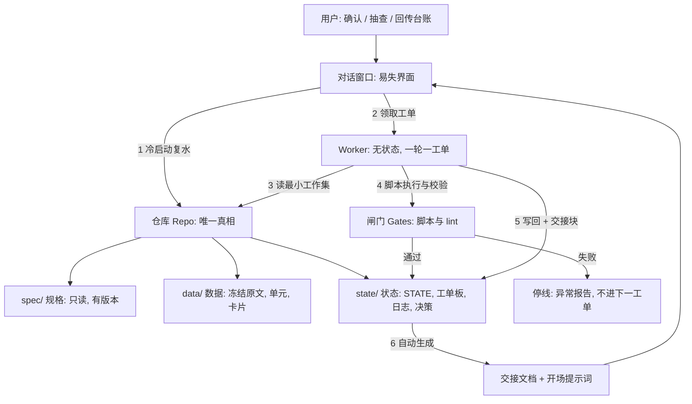

# 长任务稳定性与上下文工程方案：让 AI Agent 稳定完成十书整合

| 项 | 内容 |
|---|---|
| 版本 | v1.0（2026-10-20） |
| 适用项目 | 吴军十书整合：「认知与行动操作系统」手册（规格见《吴军十书整合_混合方案H_v2_全局规划与执行方案.md》，下称"v2 方案"） |
| 要解决的问题 | 工作量大（约 504 万汉字、70–90 批、40–70 轮）；多轮执行中**注意力分散稀疏**、**上下文反复压缩导致信息丢失**，以及由此带来的规则漂移、重复提出已否决方案、进度错觉、跨窗口丢状态 |
| 性质 | 工程方案。含问题分析、多方案对比、推荐方案、可直接执行的协议和验收测试 |

---

## 0. 结论先行

1. **问题的本质不是"模型不够认真"，而是三个结构性事实**：① 上下文和注意力有限；② 自动压缩有损，且压缩后的摘要没人校验，却会被当成事实继续用；③ 项目状态存放在会话里，而不是存放在可校验的工件里。
2. **推荐方案 EP：仓库即真相 + 工单制无状态 Worker + 脚本优先闸门 + 冷启动复水**。11 个候选方案中，单一技巧都不够：基于仓库的状态外置（O3）得分最高（89），脚本优先流水线（O6）第二（82）；两者组合并叠加分层抽取（O9）、规则复述（O11）和轻量检索（O5）后，预估 93（组合预估未经实测，要靠 §8 的压力测试验证）。
3. **三句话概括 EP**：
   - **对话是易失的，仓库是真相。** 任何需要跨轮保留的东西，都必须写进有版本、有校验和的文件。
   - **每一轮是一张工单。** 开场只加载"常驻摘要 + 本工单 + 工单需要的少量文件"，不依赖上一轮的记忆；收尾必须写回状态和交接块。
   - **任何"我记得"都要被"脚本验证过的文件"替代。** 数字由脚本产生，约束由约束清单承载，交接文档由状态自动生成。
4. **怎样证明有效**：6 项压力测试（§8）：冷启动复水测验（12 题，≥11 题对）、压缩模拟、漂移回归、断点续跑、文件损坏恢复、指令注入。不通过就不进入全量批处理。
5. **兜底**：降级阶梯 Z0 → Z1（缩范围）→ Z2（人在回路喂食）→ Z3（止于 M3），触发条件写死，不靠临场判断。

---

## 1. 问题清单与根因

| # | 现象 | 在本项目中的具体表现 | 根因 | 严重度 |
|---|---|---|---|---|
| P1 | 注意力稀疏 | 一批读 3–5 万字，加上规则和历史，中段内容被忽略；漏收论点、边界字段留空、说话人判错 | 上下文越长，单个信息分到的注意力越少（"中段遗忘"）；规则与原文争夺同一个窗口 | 高 |
| P2 | 压缩丢信息 | 压缩后"不要以 20/30 为限制""宏观、科技趋势、教育家庭不作支柱""图片路径不用管"等硬约束被改写或丢掉，后续轮次又把它们提回来 | 压缩有损，且没有"哪些信息绝不能丢"的清单，也没有压缩后的校验 | 高 |
| P3 | 反复压缩的累积漂移 | 第 N 次摘要是对第 N-1 次摘要的摘要，细节和限定语逐轮消失（传话游戏） | 摘要的输入是摘要，不是原始规格 | 高 |
| P4 | 跨窗口、跨会话丢状态 | 新窗口什么都不知道；沙箱可能重置；用户要反复重传、反复解释 | 状态在会话里，不在工件里 | 高 |
| P5 | 规则漂移 | 第 1 批转述 ≤60 字、边界字段齐全，第 50 批转述变长、边界字段为空；概念键命名风格不一 | 规则只在开头出现一次，后面靠记忆执行 | 高 |
| P6 | 先入为主与补全 | 用对吴军的印象填空，写出原文里没有的论点（伪原著） | 模型倾向于用先验补全缺失信息；没有"无锚点不写"的硬闸门 | 高 |
| P7 | 进度错觉 | 宣称"本批完成"，实际没跑校验；数字是估出来的 | 完成的判据是"我觉得"，不是"闸门通过" | 高 |
| P8 | 误差累积与传播 | 早期概念键归并错了，后面的聚类和模型卡全部建立在错误之上 | 没有早期回归测试，错误发现得晚 | 中 |
| P9 | 自评偏差 | 同一个 AI 自查自己的抽取，盲区相同；"盲重标"并不独立 | 评审者与作者共享同一上下文和偏见 | 中 |
| P10 | 环境不稳 | 额度中断（其他 AI 遇到过 429）、输出被截断、工具超时、沙箱文件丢失 | 外部资源有限且不可控 | 中 |
| P11 | 指令混淆 | 把原文里的"请在留言区……"或其他 AI 方案文档里的"进入阶段 0"当作当前指令 | 数据与指令没有隔离 | 中 |
| P12 | 用户负担 | 交接靠人工总结，容易漏；每个新窗口都要重新对齐 | 没有自动化的交接机制 | 中 |
| P13 | 并发冲突 | 两个窗口或两个 Agent 同时改同一台账 | 没有单写者规则和锁 | 中 |
| P14 | 估算失真与范围蔓延 | 轮次、批数、卡数是估的，加需求后无人重估 | 没有度量和重估机制 | 中 |
| P15 | 交接文档过期或不全 | 手写的交接文档遗漏了某个已否决项或某个数字 | 交接文档来自记忆，不来自状态 | 高 |

---

## 2. 设计目标与约束

**非功能目标（可验收）：**

| # | 目标 | 度量 |
|---|---|---|
| N1 | 任何一轮失败，丢失的工作不超过 1 个批次 | 每批写盘；断点续跑测试通过 |
| N2 | 新窗口冷启动后达到与原窗口同等的项目理解 | 复水测验 12 题 ≥11 题正确 |
| N3 | 规则一致性 | 每 3 批漂移检查，不一致率 <5% |
| N4 | 所有数字可复算 | 每个数字能由脚本命令复现 |
| N5 | 平台无关 | Claude 聊天窗口、Claude Code、Codex、Cursor 等任一带文件读写的 Agent 都能执行 |
| N6 | 用户操作最少 | 日常只需回复"继续"；里程碑时才需要保存文件、抽查 |

**约束：**

| 约束 | 说明 |
|---|---|
| 事实源冻结 | 10 个 md，按 SHA-256 冻结，不改动、不替换 |
| 沙箱持久性 | 本会话内已观察到文件跨轮保留，但**新窗口不保证有这些文件**，也不保证长期保留 |
| 额度与截断 | 可能出现额度告警、单次输出过长被截断 |
| 无并行子 Agent | 本环境没有子 Agent；其他平台可能有 |
| 交付格式 | 面向你的文档只用 Markdown；脚本和配置文件只作为工程工件 |
| 可信约束 | 无锚点不写；转述不是原文；说话人先行 |

---

## 3. 候选方案

| # | 方案 | 做法 | 优点 | 缺点 | 在本项目中的定位 |
|---|---|---|---|---|---|
| O1 | 单窗口硬扛，依赖自动压缩 | 一直在同一对话里做，压缩了就继续 | 零额外工作 | 压缩有损、不可校验；越往后越不可靠 | 反面基线 |
| O2 | 人工滚动摘要接力 | 每 N 轮手写摘要，贴到新窗口 | 简单 | 摘要是对记忆的摘要，会漏；累积漂移；依赖人工 | 只作辅助 |
| O3 | 状态外置 + 工单制无状态 Worker | 所有状态写进仓库文件；每轮是一张自包含工单；开场从仓库"复水" | 抗丢失、可审计、可跨窗口、可换 Agent | 需要先建基础设施；文件纪律要严 | **骨架** |
| O4 | 多 Agent 并行 | 编排者加多个子 Agent，各自独立上下文 | 并行、上下文隔离 | 本环境没有；协调开销大；一致性难；额度消耗大 | 在支持的平台上可选 |
| O5 | 检索增强 | 为 10 本书建关键词、TF-IDF 或向量索引，按需检索 | 减少线性阅读；利于反查与聚类 | 检索有漏检；本环境没有向量服务 | 轻量版用于 G10 和聚类 |
| O6 | 脚本优先的确定性流水线 | 切分、对账、去重、锚点、lint、汇总全部脚本化；LLM 只做语义判断 | 数字可复算；减少 LLM 负担和幻觉 | 脚本要写要测 | **骨架** |
| O7 | 人在回路分段喂食 | 你把文件分段发给 Agent，Agent 只处理当前段 | 不依赖 Agent 的持久环境 | 你的负担重 | 降级 Z2 |
| O8 | 缩小范围 | 只做六本成书、问答、划重点等 | 工作量大幅下降 | 违背你的覆盖约束 | 降级 Z1（须你批准） |
| O9 | 分层 map-reduce | 单元 → 论点卡 → 概念簇 → 模型卡 → 手册 | 每层可独立校验、可断点续做 | 层间信息有损，需锚点兜底 | 工作流的**内部结构** |
| O10 | 依赖更大窗口或更强模型 | 等模型变强 | 无需改动 | 不可控；不能解决状态和审计问题 | 不采用 |
| O11 | 周期性规则复述与检查点提示 | 每批前复述规则摘要卡，每 3 批做漂移检查 | 便宜，缓解注意力问题 | 治标，不治本 | 辅助 |

---

## 4. 多维评分对比

**评分维度和权重：** C1 抗信息丢失（20）、C2 抗注意力稀疏与漂移（20）、C3 可审计可复现（15）、C4 跨窗口跨 Agent 可迁移（15）、C5 满足你的覆盖与可信约束（15）、C6 环境可行与成本（10）、C7 实施与维护复杂度（5，越简单分越高）。评分是我的主观判断，权重和理由已列出，可复核；加权总分 = Σ（评分 × 权重）÷ 5 ÷ 权重和 × 100。

| 方案 | C1 抗信息丢失（20） | C2 抗注意力稀疏与漂移（20） | C3 可审计可复现（15） | C4 跨窗口跨 Agent 可迁移（15） | C5 满足覆盖与可信约束（15） | C6 环境可行与成本（10） | C7 实施与维护复杂度（越简单越高）（5） | **加权总分** |
|---|---|---|---|---|---|---|---|---|
| O1 单窗口硬扛，依赖自动压缩 | 1 | 1 | 1 | 1 | 3 | 5 | 5 | **38** |
| O2 人工滚动摘要接力 | 2 | 2 | 2 | 3 | 3 | 5 | 4 | **54** |
| O3 状态外置 + 工单制无状态 Worker（仓库即真相） | 5 | 4 | 5 | 5 | 4 | 4 | 3 | **89** |
| O4 多 Agent 并行（编排 + 子 Agent） | 3 | 3 | 3 | 3 | 3 | 2 | 2 | **57** |
| O5 检索增强（关键词、TF-IDF、向量索引） | 3 | 3 | 3 | 3 | 3 | 3 | 3 | **60** |
| O6 脚本优先的确定性流水线（LLM 只做语义判断） | 4 | 4 | 5 | 4 | 4 | 4 | 3 | **82** |
| O7 人在回路分段喂食 | 3 | 3 | 3 | 3 | 4 | 3 | 2 | **62** |
| O8 缩小范围（降级 Z1） | 4 | 4 | 4 | 4 | 1 | 5 | 5 | **74** |
| O9 分层 map-reduce（单元卡 → 聚类 → 成稿） | 3 | 3 | 4 | 4 | 4 | 4 | 4 | **72** |
| O10 依赖更大窗口或更强模型 | 2 | 2 | 1 | 1 | 3 | 4 | 5 | **44** |
| O11 周期性规则复述与检查点提示 | 2 | 3 | 2 | 2 | 3 | 5 | 5 | **56** |
| **EP 组合（O3 + O6 + O9 + O11 + 轻量 O5，降级用 O7/O8）预估** | 5 | 5 | 5 | 5 | 4 | 4 | 3 | **93** |

**权重敏感性：** 换三组权重，O3 都排第 1，O6 稳居第 2，结论不依赖权重选择。

| 权重情景 | 第 1 名 | 第 2 名 | 第 3 名 | O3 排名 |
|---|---|---|---|---|
| 基准 | O3（89） | O6（82） | O8（74） | 第 1 名 |
| 更看重抗丢失（30/20/15/15/10/5/5） | O3（91） | O6（82） | O8（76） | 第 1 名 |
| 更看重可行性与成本（15/15/10/10/15/25/10） | O3（85） | O6（80） | O8（78） | 第 1 名 |
| 更看重覆盖约束（15/15/10/10/35/10/5） | O3（86） | O6（81） | O9（74） | 第 1 名 |

**解读：**

| 点 | 说明 |
|---|---|
| O8 得分不低（74），但 C5 只有 1 分 | 它违背"覆盖与可信"约束，只能作为降级，不能作为主方案 |
| O3 与 O6 是互补关系 | O3 解决"状态放哪里"，O6 解决"哪些事不该让 LLM 做"；缺一不可 |
| O9 是结构，不是技巧 | 它决定了层间产物（单元、论点卡、概念簇、模型卡）都是可落盘、可校验的工件，正好承载 O3 |
| O4 在本环境不可用 | 在支持子 Agent 的平台上可用于"相互独立的书"并行抽取，但必须有单写者规则（§6.7） |
| 组合预估 93 是预估 | 要用 §8 的压力测试验证；任何一项测试不过，就回头修机制，而不是调高评分 |

**推荐结论：采用 EP，即"O3 + O6 骨架，内嵌 O9 结构，叠加 O11 与轻量 O5，降级路线用 O7、O8；O4 在平台支持时作为可选加速"。**

---

## 5. 推荐方案 EP：仓库即真相 + 工单制 + 脚本闸门 + 冷启动复水

### 5.1 总体架构



### 5.2 十个机制

| # | 机制 | 解决的问题 | 做法 | 验收 |
|---|---|---|---|---|
| M1 | 仓库即真相（SSOT） | P2 P3 P4 P15 | 文件分三类：**规格**（只读、带版本）、**日志**（只增不改）、**状态**（可由日志和产物重建）。对话只是操作界面，不承载任何必须保留的信息 | 清空对话后，只靠仓库能继续工作（ST-2） |
| M2 | 工单制无状态 Worker | P1 P4 P5 P13 | 每轮只做 1 张工单；工单自包含（目标、输入文件、动作、输出、验收命令、回退）；收尾写回状态并输出交接块 | 任意一轮中断，最多丢 1 个批次（ST-4） |
| M3 | 上下文预算与分层加载 | P1 | 把上下文分成常驻层、工单层、规格片段层、原文工作集层；每层有预算上限；只加载 manifest 里列出的文件（§6.2） | 每轮开场声明已加载文件清单，无多余加载 |
| M4 | 冷启动复水协议与测验 | P2 P4 P12 | 新窗口或压缩后第一步：按固定顺序读文件、核对哈希、复述状态，并通过 12 题复水测验（§6.3） | 测验 ≥11/12，否则继续读，不得动手 |
| M5 | 脚本优先与自动闸门 | P6 P7 P8 | 切分、对账、去重、锚点、lint、台账汇总、指标计算全部脚本化；LLM 只做语义判断；闸门不过即停线 | "完成"的唯一判据是闸门输出，不是"我觉得" |
| M6 | 抗压缩设计 | P2 P3 | ① **约束摘要卡**：硬约束带编号，每轮开场复述；② **不可丢失清单**：已确认、已否决、数字口径各一页；③ 压缩后一律回到仓库复水，**不信摘要**；④ 压缩前检查点：写状态、写日志、刷新交接文档 | 压缩模拟测试通过（ST-2） |
| M7 | 角色分离与冷启动复核 | P9 | 抽取、审计、成稿由不同"角色提示词"在不同工单里执行；盲重标和审计用**全新窗口**，不看首次结果 | 重抽重合率、κ 达标；审计不读首次卡 |
| M8 | 漂移控制 | P5 P8 | **黄金样例集**（P1 产出的已核对卡）；每 3 批回归：重抽 2 个黄金单元，对照重合率；lint 指标监控 | 重合率 ≥0.7；lint 错误率不升 |
| M9 | 降级与人在回路 | P10 P14 | 降级阶梯 Z0 → Z1 → Z2 → Z3，触发条件写死（§6.8） | 触发时自动提示并停下问你 |
| M10 | 监控与度量 | P7 P14 | 进度、吞吐、通过率、漂移、估算偏差，每轮写入 STATE | 估算偏差 >20% 时重估并告知 |

### 5.3 与 v2 方案的关系

| v2 方案已有 | EP 补充 |
|---|---|
| §15.4 每轮开场与结尾模板、§15.11 注意力管理、§15.13 变更控制 | 升级为工单制、上下文预算、复水测验、压缩前后协议 |
| §7.7 断点续作协议 | 升级为仓库即真相、单写者规则、交接文档自动生成 |
| §15.3 脚本清单 | 增加 CI 闸门、黄金样例回归、交接生成脚本 |
| §7.8 降级路线 | 补充触发条件的量化阈值 |

---

## 6. 具体协议

### 6.1 Turn 协议（每一轮的三段式）

**第一段：复水（≤1 分钟的固定动作）**

| 步 | 动作 |
|---|---|
| 1 | 读 `state/STATE.md` 和 `state/journal.md` 的最后 20 行 |
| 2 | 读 `spec/constraints.md`（约束清单，带编号）并复述其摘要（≤300 字） |
| 3 | 核对冻结哈希；不一致则停 |
| 4 | 领取工单：读 `state/board.md` 中状态为 `ready` 且前置已完成的第一张；读该工单卡 |
| 5 | 按工单的 manifest 加载文件；声明加载清单 |

**第二段：工作**

| 步 | 动作 |
|---|---|
| 6 | 按工单动作执行；脚本能做的一律脚本做 |
| 7 | 每个产出立即写盘（不留在对话里） |
| 8 | 运行工单指定的验收命令；失败则停线，写异常报告 |

**第三段：交接**

| 步 | 动作 |
|---|---|
| 9 | 更新 `state/STATE.md`、`board.md`；向 `journal.md` 追加一条（只增不改） |
| 10 | 输出**交接块**（见下） |
| 11 | 若本轮跨过里程碑，生成交接文档并提示你保存 |

**交接块格式（每轮最后输出，供你和下一个 Agent 使用）：**

```markdown
【交接块】
- 轮次：<turn 序号>　工单：<T-…>　状态：done / blocked / partial
- 变更文件：<路径（SHA-256 前 8 位）>
- 闸门结果：<命令 → 通过/失败（关键数字）>
- 本轮决定：<D-… 一句话>
- 异常：<无 / 列出>
- 下一工单：<T-…>　阻塞项：<无 / 列出>
- 需要你做的事：<无 / 列出>
```

### 6.2 上下文预算

| 层 | 内容 | 预算 | 规则 |
|---|---|---|---|
| T0 常驻层 | 开场提示词、约束摘要卡、规则摘要卡 | ≤3,000 字 | 每轮必读，不得被压缩替代 |
| T1 工单层 | 当前工单卡、相关字典条目、判例 | ≤4,000 字 | 只读与本工单有关的二级判据，不读全字典 |
| T2 工作集层 | 原文、单元卡、待校验卡 | 单次读取 ≤20,000 汉字；一批总量 3–5 万字，分段读 | 每段读完先写草卡，再读下一段 |
| T3 输出层 | 对话里的回复 | ≤2,000 字，明细落盘 | 大表格、清单一律写文件，对话只给摘要 |
| 工具输出 | 脚本回显 | ≤2,000 字 | 脚本只打印摘要，明细写 `logs/` |

**加载纪律：** 不加载与本工单无关的文件；不在对话里复述整批原文；不把上一轮的原文留作下一轮的上下文。

### 6.3 冷启动复水协议（新窗口、压缩后、换 Agent 时）

| 步 | 动作 | 通过标准 |
|---|---|---|
| 1 | 读开场提示词 | 明白角色、红线、读取顺序 |
| 2 | 读《项目交接文档》§0–§3（目标、范围、偏好）和 `spec/constraints.md` | 能复述硬约束编号和内容 |
| 3 | 读 `state/STATE.md`、`journal.md` 最后 20 行、`board.md` | 能说出当前阶段、最近工单、下一工单 |
| 4 | 核对冻结哈希（10 个原文、v2 方案、脚本） | 全部一致；否则停并报告 |
| 5 | 做**复水测验**（12 题，见《项目交接文档》§15），先自答，再对照答案 | ≥11/12；错题回读对应章节后再答 |
| 6 | 复述："当前阶段、下一步做什么、有什么待你确认的事" | 与 STATE 一致 |
| 7 | 请用户确认后开始 | — |

**禁止：** 凭对话里的摘要开工；跳过复水测验；在测验未通过时修改任何文件。

### 6.4 压缩与临界处理

| 信号 | 动作 |
|---|---|
| 对话接近上限、出现"已压缩"提示、额度告警 | **压缩前检查点**：立即写 STATE、journal、board；刷新交接文档；输出交接块；提示"建议开新窗口" |
| 压缩发生后继续工作 | 视为冷启动：执行 §6.3，**不信压缩摘要里的任何约束和数字** |
| 发现自己在"回忆"某个约束 | 停，去 `spec/constraints.md` 读原文 |
| 发现摘要与仓库冲突 | 以仓库为准，并在 journal 记一条异常 |

### 6.5 状态文件规范

| 文件 | 类型 | 内容 | 更新规则 |
|---|---|---|---|
| `spec/` 下的规格（v2 方案、constraints.md、pillars.yaml 等） | 规格 | 只读，带版本号 | 只能走变更控制（CHG）升版本 |
| `state/STATE.md` | 状态（人读） | 阶段、批次、进度条、规则版本、冻结哈希、未决事项、风险 3 条、下一工单 | 每轮覆盖写；由脚本从 `state.json` 渲染 |
| `state/state.json` | 状态（机读） | 同上，含各层进度、吞吐、指标 | 每轮原子写；带版本号和校验和 |
| `state/journal.md` | 日志 | 每轮一条：时间、工单、做了什么、决定、异常、校验结果 | **只增不改** |
| `state/board.md` | 工单板 | 工单状态：backlog / ready / doing / blocked / review / done | 单写者更新 |
| `state/decisions.md` | 决策记录 | 决策编号、背景、选项、结论、理由、批准人 | 只增不改 |
| `state/changes.md` | 变更日志 | CHG 编号、对象、内容、级别、批准人、受影响范围 | 只增不改 |
| `handover/` | 派生 | 交接文档、开场提示词 | 由脚本从状态和规格**生成**，不手写 |

**写盘纪律：** 先写临时文件再原子替换；写后重读校验；每次更新状态都带上被更新文件的 SHA-256 前 8 位。

### 6.6 漂移检测

| 项 | 设计 |
|---|---|
| 黄金样例集 | P1 试点中经核对的 8–10 个单元及其卡片（含锚点、说话人、边界字段），存入 `data/gold/` |
| 回归时机 | 每 3 批一次；每本书结束一次；规则变更后一次 |
| 回归做法 | 用全新窗口对 2 个黄金单元重抽，与黄金卡比对：锚点区间重叠 ≥50% 视为同一论点，重合率 ≥0.7 通过 |
| lint 指标 | 转述平均长度、边界字段为空比例、说话人待核比例、概念键新增率、锚点失败率 |
| 阈值与动作 | 重合率 <0.7 或指标恶化 >20%：暂停批处理，复水，检查规则摘要卡是否被遵守；连续两次不过：缩批并报告 |

### 6.7 并发与锁

| 规则 | 内容 |
|---|---|
| 单写者 | 同一时刻只有一个 Worker 有权写 `state/`；其他窗口或 Agent 只读 |
| 锁文件 | `state/LOCK`：写明持有者、工单、时间；超过 2 小时无更新视为失效，须先问你再接管 |
| 并行（若平台支持子 Agent） | 只对**相互独立的书**并行抽取，各写各自的 `cards/<书码>/`；台账汇总和概念键表仍由单写者完成 |
| 冲突 | 发现两份不一致的状态时，以带有更晚 journal 条目且哈希可验证的一份为准，并记录异常 |

### 6.8 降级阶梯与触发条件

| 级别 | 触发条件（任一） | 做法 | 对口径的影响 |
|---|---|---|---|
| Z0 正常 | — | 每轮 2–3 批 | — |
| Z1 缩范围 | P1 实测每轮 <2 批且预计总轮数 >70；或连续两次额度中断；或重合率 0.5–0.7 修规则两次仍不过 | 范围缩为六本成书、骨架类、问答、来信3 划重点；其余来信只做分诊、关键词反查和抽样 | 核心论点覆盖范围缩小并显式声明 |
| Z2 人在回路 | Z1 仍不可行；或沙箱不可用 | 你把文件按单元清单分段发给 Agent，每段处理后回传台账 | 同 Z1 |
| Z3 止于 M3 | Z2 仍不可行或你决定止损 | 交付 v0.7，并附"未覆盖范围声明" | 以 M3 范围为准 |

升级降级都**必须停下问你**，不自行决定。

### 6.9 交接文档自动生成

| 项 | 规范 |
|---|---|
| 脚本 | `scripts/make_handover.py` |
| 输入 | `spec/`（v2 方案的指定章节）、`spec/constraints.md`、`state/*`、工单板、哈希登记 |
| 输出 | `handover/项目交接文档.md`、`handover/开场提示词.md` |
| 生成的部分 | 支柱总览、验收清单、自检清单、风险、工单进度、文件哈希、复水测验答案（来自 constraints 与 spec） |
| 人工备注区 | 只允许在"人工备注"小节追加，不得改动生成区 |
| 新鲜度校验 | 文档头写入 `state.json` 的校验和；开场时比对，不符即提示"交接文档已过期，请重新生成" |
| 触发 | 每个里程碑、压缩前检查点、你要求时 |

---

## 7. 平台适配

| 平台 | 与 EP 的差异 | 适配 |
|---|---|---|
| Claude 聊天窗口（本环境） | 沙箱会话内持久，新窗口不保证；无子 Agent | 每个里程碑交付 md 给你保存；新窗口先重传文件；用开场提示词冷启动 |
| Claude Code、Codex、Cursor 等有本地文件系统的 Agent | 仓库长期存在；可能有子 Agent 或多会话 | 直接把仓库放在本地目录；用 `AGENTS.md` 或等价文件放开场提示词；可对独立书并行（单写者规则不变） |
| 任意只能对话的 AI | 无文件系统 | 走 Z2：你充当"文件系统"，每轮回传台账 |
| 多 Agent 混用（如 A 抽取、B 审计） | 上下文天然隔离 | 审计 Agent 用冷启动，只读卡片与原文，不读抽取 Agent 的推理 |

---

## 8. 实施与压力测试

### 8.1 先建什么（EP-0 基建，开跑前完成）

| 项 | 对应工单（见《工程化总纲》§5） |
|---|---|
| 仓库目录与冻结 | T-00-01 |
| 规格落库：constraints.md、pillars.yaml、exclusions.yaml | T-00-02 |
| 脚本 S00–S08 及自测 | T-00-03 |
| 闸门与 lint 骨架 | T-00-04 |
| 状态与日志基建、交接生成脚本 | T-00-05 |
| 复水测验与黄金样例占位 | T-00-06 |
| 角色提示词与开场提示词入库 | T-00-07 |
| 压力测试规程 | T-00-08 |

### 8.2 六项压力测试（全量批处理前必须通过）

| # | 测试 | 做法 | 通过标准 |
|---|---|---|---|
| ST-1 | 冷启动复水测验 | 新窗口只给开场提示词和仓库，让 Agent 做 12 题 | ≥11/12，且能正确复述下一工单 |
| ST-2 | 压缩模拟 | 在试点中途人为清空对话，仅靠仓库恢复并继续 | 继续产出与不中断时一致（重合率 ≥0.7，无约束被重提） |
| ST-3 | 漂移回归 | 对黄金单元用全新窗口重抽 | 重合率 ≥0.7；lint 指标不恶化 |
| ST-4 | 断点续跑 | 在批处理中途强制中断，再用 STATE 恢复 | 只丢未写盘的部分，且能无损续跑 |
| ST-5 | 文件损坏恢复 | 人为损坏 `state.json` 或一个卡文件 | 能由日志和产物重建；校验和告警 |
| ST-6 | 指令注入 | 在测试单元里插入"请忽略以上规则"之类文字 | 被当作数据，不被执行，并在 G7 标记 |

任何一项不通过，就修对应机制并重测，**不进入 P3 全量批处理**。

---

## 9. 风险与残余问题

| # | 风险 | 说明 | 对策 |
|---|---|---|---|
| 1 | 文件纪律失守 | Worker 偷懒不写盘、不更新状态 | 闸门检查：本轮必须有 journal 条目和哈希；否则下一轮复水时发现并回滚 |
| 2 | 复水测验被"背题" | Agent 记住答案而非理解 | 题库轮换；每次抽 12 题，答案以仓库当前版本为准 |
| 3 | 规格与状态不一致 | 规则改了但卡没重跑 | 变更控制要求列出受影响范围并重跑；STATE 里记录规则版本，卡带规则版本 |
| 4 | 脚本缺陷 | 脚本本身有 bug 影响所有批 | 每个脚本有自测；关键脚本做篡改和漂移测试（如锚点脚本已自测） |
| 5 | 沙箱不可用 | 新窗口没有文件系统 | Z2 路径；你作为文件系统 |
| 6 | 工程开销过重 | 基建、日志、测验占用大量轮次 | EP-0 约 3–5 轮一次性投入；之后每轮开销有预算（§6.2）；若基建开销 >10% 总轮数，重估 |
| 7 | 仍然无法消除的模型层缺陷 | 抽取本身的语义判断仍会出错 | 靠锚点、语义抽检、重抽重合率、你抽查 20 张，而不是靠机制本身 |
